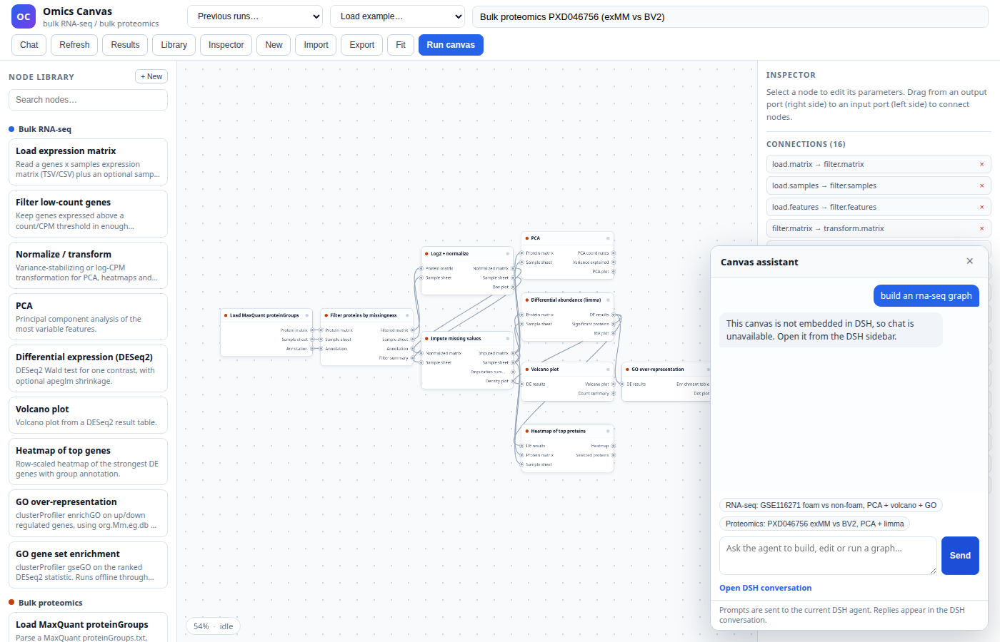
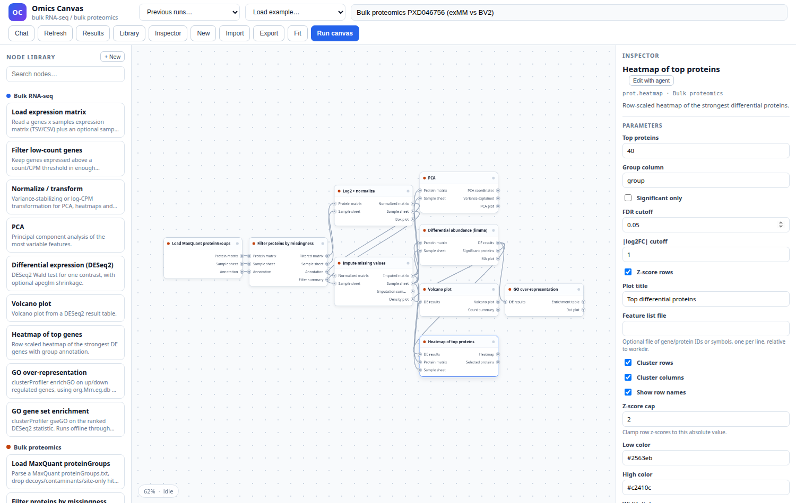
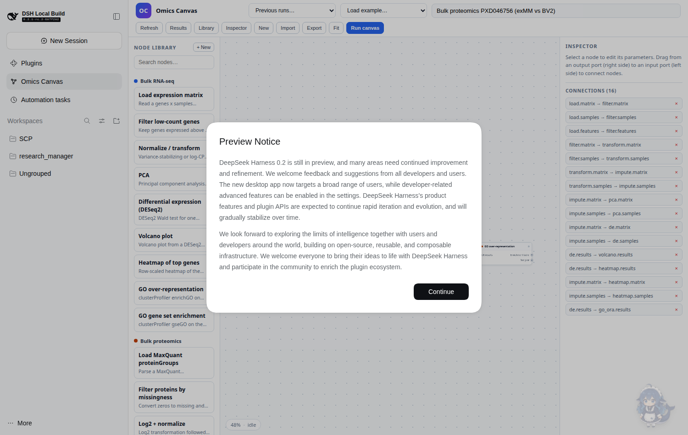

# dsh-omics-canvas

[English main README](README.md) | [中文主文档](README.zh.md)

A DSH bundle that puts the **Omics Canvas** editor into the DSH Web sidebar and
runs its existing Python/R engine as a managed child process. The design
rationale is in the main [README](README.md#design-philosophy).

## What it contributes

- **Host half** (`src/index.js`):
  - starts `python -m omics_canvas serve` on a private `127.0.0.1` port,
  - waits for `/api/catalog`,
  - proxies it under `/omics-canvas` through the DSH `webServer`,
  - stops the child process when the plugin row unloads.
- **Browser half** (`client/client.js`):
  - registers the **Omics Canvas** entry in the sidebar (`sidebar.panellist`),
  - registers the matching global main panel (`main`) as a full-height iframe
    pointing at `/omics-canvas/`.

Because the proxy is same-origin, the canvas keeps its own editor, run API,
artifact links and downloads without exposing a second public port. The Python
server still binds to loopback only.

## Prerequisites

- A DSH Web profile (`web` here) and the `dsh` CLI.
- The **`scptools`** conda environment with R, `DESeq2`, `limma`,
  `clusterProfiler`, `ComplexHeatmap`, `org.Mm.eg.db`, `org.Hs.eg.db`, and
  Python 3 with `PyYAML` (and `pandas` for Python nodes).
- This merged package tree. Data paths in graphs resolve against `workdir`
  (default: the DSH process cwd).

## Install

In this workspace the bundle is already linked into the `web` profile, so the
only step is enabling **Omics Canvas** in **Plugins**. For a fresh profile,
install it with:

```bash
dsh plugin --profile web add /path/to/dsh-omics-canvas
dsh --profile web --dump-config | grep -A4 omics-canvas
```

Then refresh the DSH Web page. An **Omics Canvas** entry appears in the
sidebar; select it to open the canvas. If it was switched **Off** in
**Plugins**, switch it back **On**. A DSH Web process that was already running
before a Host-code change must be restarted once so it loads the new plugin
module and respawns the Python child; later row changes can compose through
HMR.

To remove it:

```bash
dsh plugin --profile web remove dsh-omics-canvas
```

## Agent tools

The host registers these model-facing tools. They call the managed Python
server's `/api/*` endpoints, so they share validation, execution, caching and
report generation with the browser panel.

| Tool | Purpose |
|---|---|
| `omics_canvas_catalog` | Node types, ports, parameter schemas |
| `omics_canvas_validate` | Validate a graph without running it |
| `omics_canvas_run` | Start a graph, return a run id |
| `omics_canvas_status` | Per-node status, duration, cache hit, artifacts |
| `omics_canvas_list_runs` | Previous runs |
| `omics_canvas_upsert_node` | Create/update a custom R or Python node |
| `omics_canvas_node_code` | Read/write node code (built-in override or custom) |
| `omics_canvas_delete_node` | Delete a custom node |
| `omics_canvas_reset_node_code` | Remove a built-in override |
| `omics_canvas_cache` | Cache stats or clear |
| `omics_canvas_get_canvas` | Read the open canvas document by id |
| `omics_canvas_patch_canvas` | Set node params / env, add/remove nodes or edges |
| `omics_canvas_read_artifact` | Read text artifacts / get binary URLs |
| `omics_canvas_export_run` | HTML report and ZIP bundle URLs |

Custom nodes accept `language: "r" | "python"`; R code lives in
`r/custom/<id>.R`, Python code in `py/custom/<id>.py`. A node may also carry
`env: "<conda env>"`; both runtimes resolve the interpreter from that
environment (default `scptools`).

Typical agent sequence:

```text
omics_canvas_catalog
→ omics_canvas_validate {graph}
→ omics_canvas_run {graph}
→ omics_canvas_status {run_id}
→ omics_canvas_read_artifact {run_id, path}
→ omics_canvas_export_run {run_id}
```

## Can the agent build a graph from conversation?

Yes. The plugin is **tool-enabled, not a standalone LLM**: the DSH agent reads
the request, calls `omics_canvas_catalog` to learn node types and parameters,
constructs a graph, validates it, runs it, polls status, reads artifacts and
optionally exports the report. The canvas itself does not invent analyses; the
model does the planning and the plugin enforces structure (typed ports,
required parameters, DAG validation).

Example prompts:

- “用 GSE116271 的表达矩阵做 foam vs non-foam 的 RNA-seq 分析，画 PCA、火山图和
  GO 富集，最后给我报告。”
- “在 PXD046756 上做 exMM vs BV2 的 limma 差异分析，先看 PCA 和缺失值分布。”
- “新增一个 `custom.log2fc` 节点，输入 DE 表，输出 |log2FC| 最大的前 50 个基因，
  然后接到现有 RNA-seq 图里。”
- “把上次成功运行的图导出成可复现的代码包和 HTML 报告。”

The agent can also create/edit nodes (`omics_canvas_upsert_node`,
`omics_canvas_node_code`), choose the per-node `env`, and use
`omics_canvas_cache` to inspect or clear cached intermediates.

### Chat from inside the canvas

The **Chat** button in the canvas toolbar opens a drawing-board assistant.
Prompts are forwarded with `postMessage` to the DSH host half, which submits
them to the **current session** via the session controller. Replies stay in the
normal DSH conversation; the drawer provides an **Open DSH conversation** link.
This keeps the canvas deterministic and lets the regular agent/tools do the
planning. A standalone canvas (not inside DSH) shows an explanatory notice
instead of pretending to chat.





### Edit one node with the agent

Select a node and press **Edit with agent**. The prompt includes the canvas id,
the selected node id/type/params/env, its upstream/downstream edges, and a
workflow:

```text
omics_canvas_get_canvas
→ omics_canvas_patch_canvas {set_node_params | update_node | ...}
→ omics_canvas_node_code (read/write an override)
→ omics_canvas_validate
→ omics_canvas_run
```

The canvas is a small server-side document (`canvases/<id>.json`). The browser
saves it with optimistic revision checks and polls every 3 s, so an agent patch
appears without a reload. The inspector also has **Reload code** to pull a code
override written by the agent.

Built-in node code is no longer a hidden black box: the inspector loads the
actual R/Python implementation (for example `rna_heatmap <- function(task)`),
lets the user edit it, and saves it as an override without touching the
shipped source. Reset removes the override.

The heatmap nodes expose the common customization knobs directly: feature-list
file, row/column clustering, row labels, z-score cap, low/high colors, width
and height. Anything beyond those can be changed in the code editor or by the
agent.

`rna.gsea_kegg` is the KEGG counterpart of the offline GO GSEA node. It uses
significant genes only, maps Ensembl IDs to ENTREZ with a symbol fallback, runs
`gseKEGG` for mouse/human, and writes a KEGG table, a pathway dot plot and a
significant-gene heatmap with left/right running-ES panels plus the bottom
reversed color bar.

## Troubleshooting

| Symptom | Action |
|---|---|
| Sidebar entry missing | Plugins → **Omics Canvas** → **On**, then refresh |
| `omics_canvas_*` schema error | Restart the running `dsh web` once (Host module was cached) |
| Panel loads but API 503 | Check the Python child startup log; `pluginRoot`, `python`, `scptools` must be valid |
| `/api/canvases/...` returns 404 after an update | The Python child is still the old process: toggle **Omics Canvas** Off/On, or restart `dsh web` |
| `Rscript` not found | `conda run -n scptools which Rscript`; ensure conda is on PATH |
| Custom node save fails | R code must parse and define `run(task)`; Python must compile and define `def run(task)` |
| Wrong data paths | Set `workdir` in the profile patch to the workspace root |

## Configuration

Defaults live in `cordis.patch.yml`; override them in the profile's
`cordis.patch.yml` (or another patch layer) under the same row id:

```yaml
- id: omics-canvas
  config:
    pluginRoot: /path/to/dsh-omics-canvas
    workdir: /path/to/workspace
    python: python3
    env: scptools
    runsDir: /path/to/dsh-omics-canvas/runs
    port: 0
    startServer: true
    canvasUrl: ""
    readyTimeoutMs: 30000
```

| Field | Meaning |
|---|---|
| `pluginRoot` | This merged package root (contains `omics_canvas/`, `r/`, `py/`) |
| `workdir` | Base directory for relative data paths in canvas graphs |
| `python` | Interpreter that can import `omics_canvas` (`PyYAML` required) |
| `env` | Default conda environment for R and Python nodes |
| `runsDir` | Run output directory; empty means `<pluginRoot>/runs` |
| `port` | Fixed loopback port; `0` asks the OS |
| `startServer` | `false` reuses an already-running server on `port` |
| `canvasUrl` | External canvas URL; when set, no Python server is started |
| `readyTimeoutMs` | Startup wait before the proxy reports 503 |

## Verified flow

The bundle was installed into the `web` profile and exercised in a fresh DSH
Web instance:

- the sidebar shows **Omics Canvas**;
- the panel loads `/omics-canvas/` with the example graph (9 nodes, examples
  and previous runs visible);
- `POST /omics-canvas/api/validate` and `GET /omics-canvas/api/runs` answer
  through the proxy;
- a small `rna.load_matrix` run completes (`load: success`) inside the panel;
- a second run of the same node is a cache hit (`cache_hit: true`);
- the inspector loads/edits R or Python node code, selects a per-node conda
  environment, and the Results drawer previews tables;
- the host tool registry exposes all `omics_canvas_*` tools (fake-context
  harness plus production tool registration).



## Requirements

- The `scptools` conda environment with R, `DESeq2`, `limma`,
  `clusterProfiler`, `ComplexHeatmap`, `org.Mm.eg.db`, `org.Hs.eg.db`.
- Python 3 with `PyYAML`.
- The Omics Canvas source tree at `pluginRoot` (this workspace already has it
  at the package checkout).

The host half resolves `Rscript` through `conda run -n scptools` exactly like
the standalone canvas, so the analysis still runs in the requested
environment.

## Notes and limits

- The panel is an iframe, not a React reimplementation. It inherits the
  standalone canvas's UX and isolates its state; the trade-off is that DSH
  cannot deep-link into individual nodes/runs yet.
- The proxy forwards HTTP only. There are no WebSockets in the canvas, so this
  is sufficient.
- The plugin starts one Python process per loaded row. HMR reloads stop the old
  process before starting the new one.
- The tool declarations are registered on the host plugin. Their `parameters`
  are explicit JSON Schema objects (`type: "object"`); older revisions used a
  shorthand that the model API rejected. A DSH Web process started before this
  change must be restarted once so the corrected declarations and the new
  Python child process are loaded.
- Local data paths resolve against `workdir`, not the DSH process working
  directory, so the example graphs keep working from any launch location.

## Implementation status

See [docs/implementation_status.md](docs/implementation_status.md) for the
completed plan items and known gaps.

## Layout

```text
dsh-omics-canvas/
├── package.json          # dsh.bundle + dsh.client manifest
├── cordis.patch.yml      # inserts the omics-canvas row
├── src/index.js          # host: child process + /omics-canvas proxy
├── client/client.js      # browser: sidebar icon + main iframe panel
├── omics_canvas/         # Python engine package (catalog, engine, server, report)
├── r/                    # R nodes and dispatcher
├── py/                   # Python node dispatcher and helpers
├── web/                  # standalone canvas editor
├── specs/                # under omics_canvas/specs/
└── README.md             # canvas/engine documentation
```
