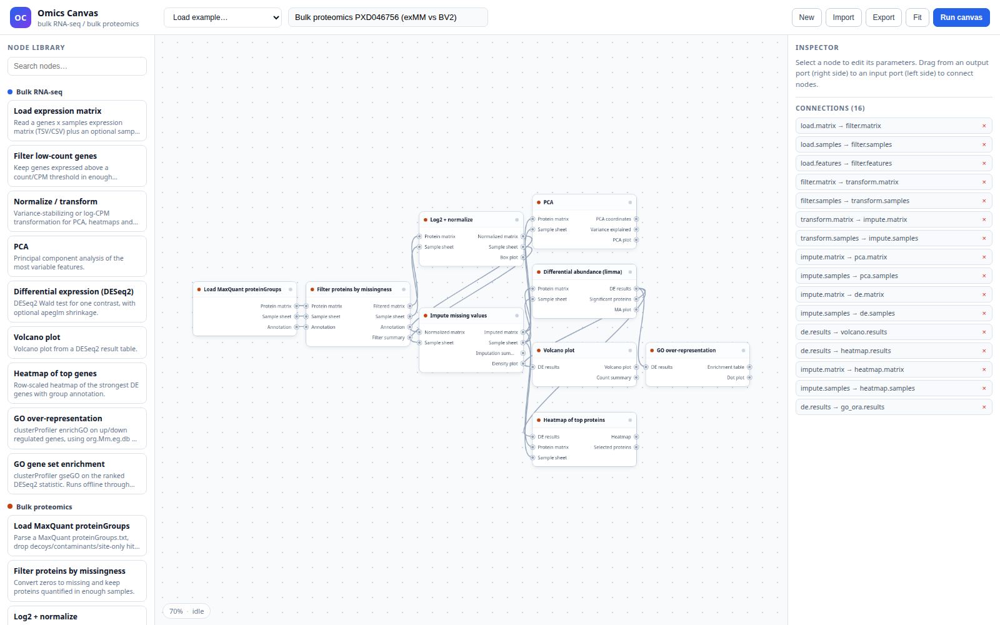

# Omics Canvas

**English** | [中文](README.zh.md)

A canvas-style, node-graph plugin for **omics analysis**. The graph engine is
general; the repository ships with two end-to-end bulk examples that run on real
data already present in this workspace:

- **Bulk RNA-seq** — expression matrix → filtering → normalization → PCA →
  DESeq2 → volcano / heatmap → GO over-representation / GO or KEGG GSEA.
- **Bulk proteomics** — MaxQuant `proteinGroups.txt` → filtering → log2 and
  normalization → missing-value imputation → PCA → limma → volcano / heatmap →
  GO over-representation.

Every node is executed by R or Python inside the existing `scptools` conda
environment (each node can select another conda environment). The canvas is a
dependency-free browser editor; the same graph can also be run headlessly from
the command line, and a DSH agent can build and run graphs through tools.



## Design philosophy

Omics analysis is not a standard automation problem. Every study starts from a
different scientific question and routinely customises its workflow. That
customisation is a feature: it lets a lab answer the question quickly and
exactly. It is also a liability: bespoke scripts, parameters, figures and
one-off environments accumulate, and the cost of maintaining, reviewing and
updating them is paid later, often by someone else.

The strategy here is to reduce an analysis to a **computation graph** and each
step to a **computational node**. The graph makes the analysis explicit and
reviewable; the node makes a step reusable and replaceable. Earlier cloud
platforms and graph systems pursued the same abstraction, but their graphs and
nodes were expensive to change: adding a step, tuning a parameter or adopting a
new method often meant editing platform code, redeploying, or forking a
workflow.

This plugin makes the graph and its nodes **agent-editable and
human-editable**. The agent can assemble a graph from the catalog, rewrite node
parameters or implementation, validate the result, run it and inspect the
artifacts; the canvas exposes the same operations directly. The contract is the
graph, the editor is the agent (or the user), and the unit of reuse is the node.

Once an analysis is fixed, its graph is fixed. That is the point: code and
functions can be reused across projects, the same graph can be re-run on new
omics data, and reproduction becomes an explicit graph plus its inputs,
parameters, environments and cached artifacts rather than an oral tradition of
scripts.

## Install and use in DSH

The package is a single DSH bundle. From the workspace root:

```bash
dsh plugin --profile web add /path/to/dsh-omics-canvas
```

Then refresh the DSH Web page, open **Plugins**, and make sure **Omics Canvas**
is **On**. The sidebar entry opens the canvas. After a Host-code change,
restart the running `dsh web` once so the new tool declarations and Python
child are loaded. See [README.dsh.md](README.dsh.md) for details, agent
examples and troubleshooting.

## What it can do

- 19 built-in nodes for the bundled bulk RNA-seq / proteomics examples, plus custom R and Python nodes.
- Per-node code editing with built-in overrides; code is syntax-checked before
  replacing a working implementation.
- Per-node conda environment selection.
- Per-node timing, content-addressed result cache, and cache stats/clear.
- Self-contained HTML publication reports and ZIP bundles with one code driver
  per node.
- 14 `omics_canvas_*` tools for conversational graph construction, node editing and runs.
- A **Chat** drawer in the canvas that forwards a prompt to the current DSH
  session; replies appear in the DSH conversation (the drawer has an
  “Open DSH conversation” link).

## Quick start

```bash
conda activate scptools
cd /path/to/dsh-omics-canvas

# Browser canvas + local run API (workdir = workspace root)
PYTHONPATH=. python -m omics_canvas serve --workdir /path/to/workspace
# open http://127.0.0.1:8765/
```

Headless execution (run from the workspace root so the example's relative
paths resolve). The bundled examples reference data in the authoring
workspace; update `expression` / `sample_sheet` for your own data:

```bash
cd /path/to/dsh-omics-canvas
PYTHONPATH=. python -m omics_canvas run \
  omics_canvas/specs/examples/rna_seq_gse116271.json \
  --workdir /path/to/workspace

PYTHONPATH=. python -m omics_canvas run \
  omics_canvas/specs/examples/bulk_proteomics_pxd046756.json \
  --workdir /path/to/workspace
```

Other commands:

```bash
PYTHONPATH=. python -m omics_canvas list
PYTHONPATH=. python -m omics_canvas validate <graph.json>
PYTHONPATH=. python -m omics_canvas runs
PYTHONPATH=. python -m omics_canvas show <run_id>
```

`run` accepts `--target <node_id…>` to execute only the ancestors of a node,
`--resume` to continue an interrupted run, and `--run-dir` to reuse a fixed
directory.

## Node catalog

| Category | Node | Purpose |
|---|---|---|
| RNA-seq | `rna.load_matrix` | Read a genes × samples matrix plus optional sample sheet |
| RNA-seq | `rna.filter` | Keep genes above a count/CPM threshold |
| RNA-seq | `rna.normalize` | VST, rlog, log-CPM, TMM or log2 |
| RNA-seq | `rna.pca` | PCA of the most variable genes |
| RNA-seq | `rna.de` | DESeq2 Wald test for one contrast |
| RNA-seq | `rna.volcano` | Volcano plot |
| RNA-seq | `rna.heatmap` | Row-scaled heatmap of top DE genes |
| RNA-seq | `rna.enrich_ora` | GO over-representation (`org.Mm.eg.db` / `org.Hs.eg.db`) |
| RNA-seq | `rna.enrich_gsea` | GO gene-set enrichment on the DESeq2 statistic |
| RNA-seq | `rna.gsea_kegg` | KEGG GSEA on significant genes: table, pathway dot plot and heatmap with running-ES side panels |
| Proteomics | `prot.load_maxquant` | Parse MaxQuant proteinGroups, drop decoys/contaminants |
| Proteomics | `prot.filter` | Zeros → missing, filter by valid values / peptides |
| Proteomics | `prot.transform` | log2 and median / quantile normalization |
| Proteomics | `prot.impute` | MinProb, MinDet or kNN imputation |
| Proteomics | `prot.pca` | PCA of the imputed protein matrix |
| Proteomics | `prot.de` | limma moderated t-test |
| Proteomics | `prot.volcano` | Volcano plot |
| Proteomics | `prot.heatmap` | Row-scaled heatmap of top proteins |
| Proteomics | `prot.enrich_ora` | GO over-representation from MaxQuant gene names |

GO enrichment nodes are offline: they use `GO.db` plus the organism
annotation package. `rna.gsea_kegg` uses `clusterProfiler::gseKEGG` and reads
the KEGG pathway annotation from `rest.kegg.jp`, so it needs network access
(or a populated KEGG cache).

Heatmap nodes expose `feature_list`, row/column clustering, row labels,
`z_cap`, low/high colors and output size. The inspector also loads the actual
built-in implementation (for example `rna_heatmap <- function(task)`) and
saves edits as an override, so anything not covered by parameters can be
changed in code or by the agent.

## Outputs

Each run is written under `runs/<timestamp>_<slug>/`:

```text
runs/20261018_231806_rna-seq-gse116271-foam-vs-non-foam/
├── manifest.json          # run status, node status, metrics, artifact index
├── graph.json             # exact graph that was executed
├── logs/<node>.log        # R stdout/stderr for each node
└── <node>/                # task.json, result.json, tables and PNG/PDF figures
```

The manifest is the single source of truth for the UI: it records per-node
status, duration, cache hit/key, parameters, messages, metrics and artifact
URLs. It also records `total_duration_s` (sum of node time),
`wall_duration_s`, `slowest_node` and the cache summary. Artifact links served
by the canvas look like `/api/runs/<run_id>/files/<node>/<file>`.

Every run also exposes:

- `GET /api/runs/<id>/report` — self-contained HTML report (graph SVG,
  figures, table previews, methods, timings, cache).
- `GET /api/runs/<id>/export` — ZIP bundle with `report.html`, `graph.svg`,
  one `code/<node>.R` or `code/<node>.py` driver per node, `run_all.sh`,
  `README.md` and all artifacts.

## Canvas editor

- Click a node in the left library to add it.
- Drag a node header to move it; drag the canvas to pan; wheel to zoom.
- Drag from an output port (right side) to an input port (left side) to connect.
- Select a node to edit parameters in the right inspector.
- `Run canvas` executes the graph and colours each node by status; artifacts
  (including PNG figures) appear in the inspector when a node finishes.
- `Previous runs` reloads a completed run's graph, statuses and artifacts
  without re-executing it.
- `Export` / `Import` exchange the graph as JSON; the latest graph is also kept
  in browser `localStorage`.

The editor and API bind to `127.0.0.1` by default. Use `--host 0.0.0.0` only on
a trusted network.

## Graph format

```json
{
  "name": "RNA-seq example",
  "nodes": [
    {
      "id": "load",
      "type": "rna.load_matrix",
      "x": 40,
      "y": 260,
      "params": {
        "expression": "scp_CAD/res/txt/GSE116271_bulk_2026-10-15/counts_matrix.tsv",
        "sample_sheet": "scp_CAD/res/txt/GSE116271_bulk_2026-10-15/samples.tsv"
      }
    }
  ],
  "edges": [
    {"from": "load", "from_port": "expr", "to": "filter", "to_port": "expr"}
  ]
}
```

- `nodes[].id` must be unique.
- `edges[].from_port` / `to_port` must exist in the catalog and have the same
  type (`matrix`, `table`, `plot`).
- Each input port accepts at most one edge.
- The graph must be acyclic.

## Custom nodes and code editing

Every node has an editable code section in the inspector:

- **Built-in nodes** load the shipped implementation (for example
  `rna_heatmap <- function(task)`). Saving writes
  `r/overrides/<node_id>.R`; the shipped implementation stays untouched, and
  `Reset override` removes it.
- **Custom nodes** are full user nodes in **R or Python**. `+ New` opens a
  dialog for id (`custom.*`), language, title, ports (`id:type`), parameter
  JSON and code. R nodes write `r/custom/<id>.R`; Python nodes write
  `py/custom/<id>.py`. Both are declared in `specs/custom_nodes/<id>.json`.
- **Validation** runs `Rscript parse()` for R and `compile()` for Python before
  a file is replaced, so broken code does not overwrite a working node.
- **Runtime environment** is selectable per node in the inspector. The default
  comes from the server/plugin config (`scptools`); the dropdown lists conda
  environments from `GET /api/environments`. Both R and Python nodes run in the
  selected environment, and the environment is part of the cache key.
- **Agent path**: the DSH tools `omics_canvas_upsert_node`,
  `omics_canvas_node_code`, `omics_canvas_delete_node` and
  `omics_canvas_reset_node_code` cover the same operations.

R custom code receives `task$params`, `task$inputs` and `task$outdir`; Python
custom code receives the same values as a dict (`task["params"]`,
`task["inputs"]`, `task["outdir"]`) and may `from common import write_table`.
Both must return:

```r
list(
  ok = TRUE,
  artifacts = list(port = list(file = "file.tsv", type = "table", label = "Label")),
  metrics = list(n = 1),
  messages = character()
)
```

Ports use `matrix`, `table`, `plot` or `any`; `any` connects to any type.
Python nodes are dispatched by `py/dispatch.py`, which imports the node module
and calls `run(task)`.

## Timing and result cache

- Each node records `started_at`, `finished_at`, `duration_s`; the run records
  wall time and the slowest node.
- Node results are cached by a content-addressed key: node type, resolved
  parameters, input file contents, node source/override, `common.R` and
  `dispatch.R` hashes, and the R environment.
- A cache hit copies the cached artifacts into the new run directory and skips
  the R process; the node is marked `cached`.
- CLI: `--no-cache`, `--cache-dir`, and `omics_canvas cache stats|clear`.
- API: `GET /api/cache`, `DELETE /api/cache`.
- The UI shows cache hits in the run banner, a `cached` pill in the inspector,
  and cache stats/clear in the Results drawer.

## DSH tools

When the canvas is mounted as the DSH bundle, the host exposes:

| Tool | Purpose |
|---|---|
| `omics_canvas_catalog` | List node types, ports and parameter schemas |
| `omics_canvas_validate` | Validate a graph |
| `omics_canvas_run` | Start a graph run |
| `omics_canvas_status` | Per-node status, timing, cache and artifacts |
| `omics_canvas_list_runs` | List previous runs |
| `omics_canvas_upsert_node` | Create/update a custom R or Python node |
| `omics_canvas_node_code` | Read or write node code |
| `omics_canvas_delete_node` | Delete a custom node |
| `omics_canvas_reset_node_code` | Remove a built-in override |
| `omics_canvas_get_canvas` | Read the open canvas document |
| `omics_canvas_patch_canvas` | Patch node params/edges in the open canvas |
| `omics_canvas_cache` | Cache stats / clear |
| `omics_canvas_read_artifact` | Read text artifacts or get binary URLs |
| `omics_canvas_export_run` | Report and bundle URLs |

## Environment and dependencies

- R 4.5.3 from the `scptools` conda environment (475 packages installed),
  including `DESeq2`, `limma`, `edgeR`, `clusterProfiler`, `fgsea`,
  `ComplexHeatmap`, `MSnbase`, `org.Mm.eg.db`, `org.Hs.eg.db`, `GO.db`.
- Python ≥ 3.9 with `PyYAML` (the `scptools` Python 3.12 interpreter has it).
- The R bridge resolves `Rscript` through `conda run -n scptools which Rscript`
  the first time a run starts. Override with `OMICS_CANVAS_RSCRIPT`.

## Limitations

- The web canvas is still an iframe when hosted in DSH; the standalone server
  has no authentication beyond the DSH proxy. Use it on a trusted local network.
- Custom nodes execute arbitrary R code with the host user's permissions. Only
  trusted users should be allowed to create/edit code.
- Current differential analysis handles a single two-group contrast. Multi-
  factor designs can be passed via `design_formula` for RNA-seq but not yet for
  proteomics.
- Proteomics imputation is deliberately simple (left-censored normal or kNN);
  it is not a substitute for the noise-aware MBR work in `flowscp`.
- GO enrichment is offline. `rna.gsea_kegg` reads KEGG pathway annotation
  from `rest.kegg.jp`, so it needs network access (or a populated KEGG cache).
  Reactome/MSigDB gene sets are future work.
- The DSH panel is an iframe around the standalone canvas rather than a native
  React reimplementation; the `web/` directory and `/api/*` endpoints remain the
  integration surface for other shells.


## DSH plugin

This canvas is also packaged as a DSH bundle in
[`README.dsh.md`](README.dsh.md): it registers an
**Omics Canvas** sidebar panel in the DSH Web UI, starts this Python server on
a private loopback port and proxies it under `/omics-canvas`. The panel is a
same-origin iframe, so the editor, run API and artifact links are unchanged.

## Documentation

- [`docs/project_resources.md`](docs/project_resources.md) — inventory of
  datasets and code in this workspace that the plugin can consume.
- [`docs/architecture.md`](docs/architecture.md) — graph engine, node contract,
  API and extension guide.
- [`docs/implementation_status.md`](docs/implementation_status.md) — plan
  checklist, completed items and known gaps.

## Extending the plugin

1. Add a node entry to `omics_canvas/specs/nodes.yaml` with `id`, `title`,
   `category`, `r_function`, `r_file`, ports and parameters.
2. Implement `rna_*` / `prot_*` (or a new prefix) in `r/rna_nodes.R`,
   `r/prot_nodes.R`, or a new R file, returning
   `list(ok = TRUE, artifacts = ..., metrics = ..., messages = ...)`.
3. Reuse `common.R` helpers (`pca_impl`, `volcano_impl`, `heatmap_impl`,
   `ora_impl`, `gsea_impl`, `matrix_with_anno`, …).
4. Add an example graph under `omics_canvas/specs/examples/` and validate it
   with `python -m omics_canvas validate`.
